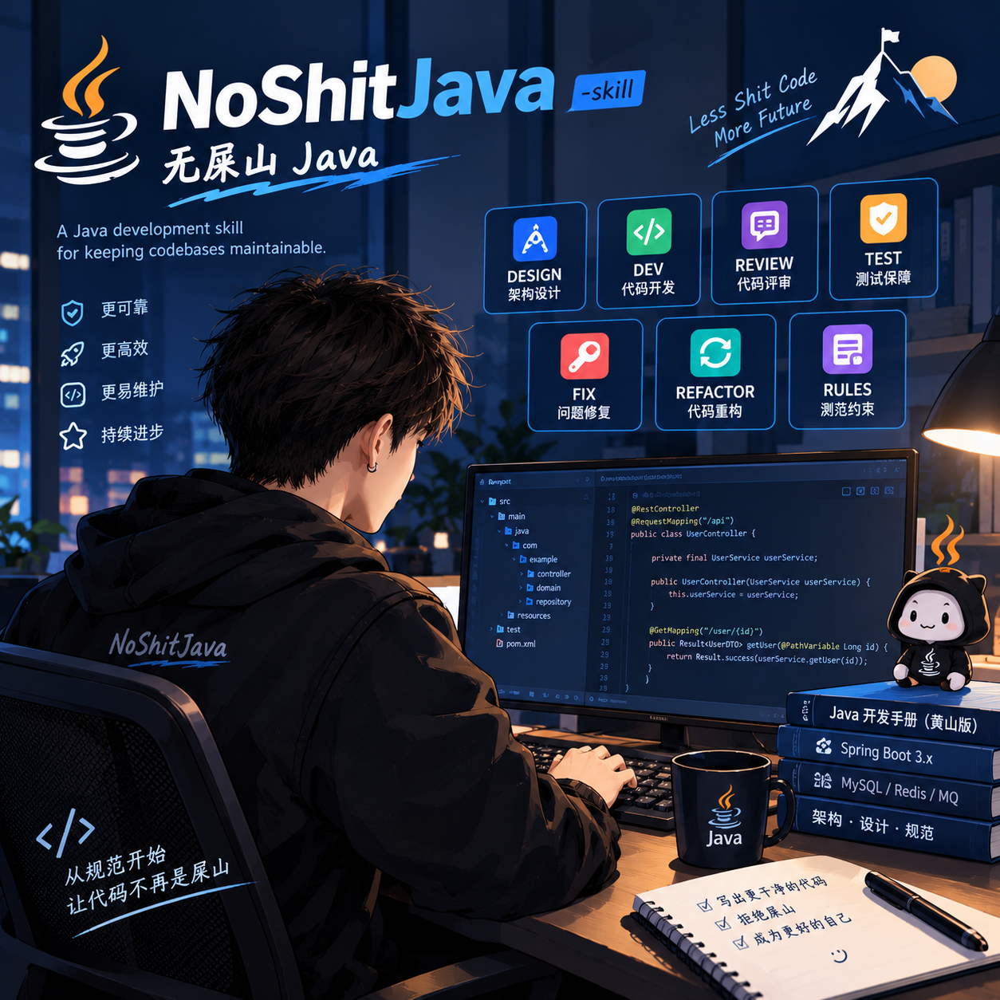
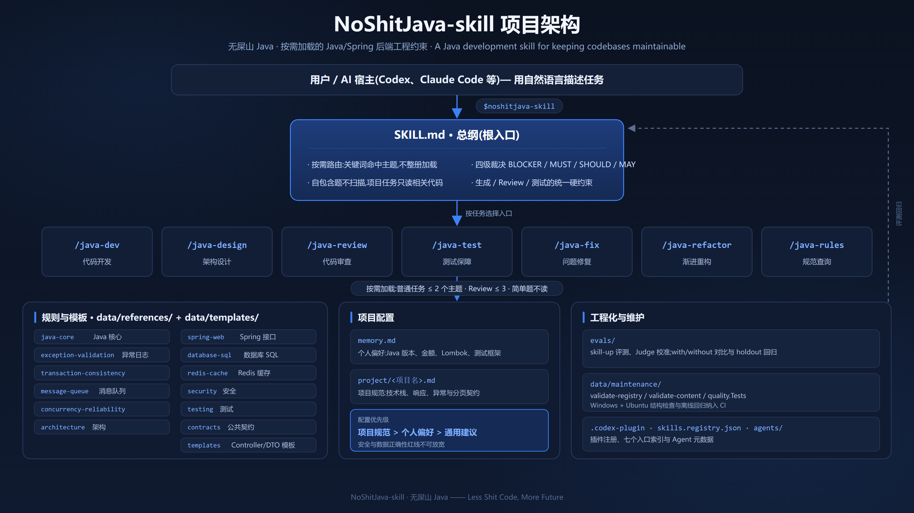
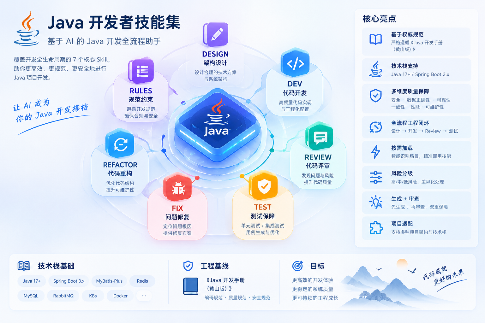

# NoShitJava-skill

English · [简体中文](README.md) · [日本語](README.ja.md) · [Español](README.es.md)

<div align="center">
  
  <p><strong>No-Shit-Mountain Java — an AI assistant for the full Java development cycle</strong><br>
  <sub>A Java development skill for keeping codebases maintainable.</sub></p>
</div>

> An on-demand loading skill for Java/Spring backend projects: code generation, API design, database changes, code review, and test completion all follow consistent, production-grade constraints.

[](LICENSE)
[](https://github.com/wzj1228516103/NoShitJava-skill/actions/workflows/quality.yml)
[](https://www.oracle.com/java/technologies/javase/)
[](https://spring.io/projects/spring-boot)





## About

NoShitJava-skill targets Java/Spring backend projects. It builds on the Alibaba *Java Development Manual (Huangshan Edition)* plus common engineering practices, reads only the rules relevant to the current task, and helps with development, design, review, testing, bug fixing, refactoring, and rule lookup; it does not replace your project's own conventions or security review.

For the full rule documentation, repository layout, and maintenance guide, read the [detailed README](README-DETAILS.md) (Chinese).

## The No-Shit-Mountain Theory

Sibling of the Big Water theory (drink more water) and the Big Sleep theory (sleep more), governing the third big thing in your day: **writing code**. One sentence:

> A shit mountain is never written in one sitting — it accretes one "this is fine for now, we'll fix it later" at a time.

Three commandments: **think before you build; back boundaries and failure paths with tests; never compromise on security or data correctness.** This skill puts the theory into practice for AI — seven entries that enforce the commandments, rules taken on demand.

## Seven Entries

| Entry | Use it to | Primary deliverable |
|---|---|---|
| `/java-dev` | Write new features | Implements APIs, business logic, or code skeletons in the project's existing style |
| `/java-design` | Design first | Maps out APIs, table design, transactions, and likely risks |
| `/java-review` | Check code | Reports evidence-backed issues with locations and suggested fixes |
| `/java-test` | Add tests | Covers happy paths, boundaries, and failure cases |
| `/java-fix` | Debug | Finds root causes, applies necessary fixes, and adds regression tests |
| `/java-refactor` | Clean up legacy code | Improves code step by step while preserving behavior |
| `/java-rules` | Look up standards | Explains rules and their applicability with concrete examples |

`/java-dev` and the other names above are entry names, not necessarily slash commands built into your AI tool. If they don't work, no problem — once the skill is enabled, just describe what you need in plain language.

## Measured Impact

The same set of Java/Spring tasks was evaluated with and without the skill and scored item by item against the rules:

| **Metric** | **With this skill** | **Without** | **Gain** |
|---|---:|---:|---:|
| **Average quality-assertion pass rate (holdout-v6)** | **100.00%** | 88.89% | **+11.11pp** |
| **Full-case pass rate (holdout-v6)** | **100.00%** (15/15) | 73.33% (11/15) | **+26.67pp** |
| **Worst-case average quality rate (holdout-v6)** | **100.00%** | 77.78% | **+22.22pp** |
| **Average quality-assertion pass rate (eval-v9)** | **100.00%** | 91.67% | **+8.33pp** |

Quality-assertion pass rates are counted over Judge (automated grader) quality assertions and exclude the `expect` gate. holdout-v6 is the held-out task set and eval-v9 the main suite; their evaluation configs, cases, and metrics live in [`evals/`](evals/README.md). The source tasks participated in tuning, so these results serve as regression verification, not evidence of independent generalization gains.

## Coverage

| Area | What's covered |
|---|---|
| Java fundamentals | Naming, date/time, money, collections, concurrency, resource cleanup |
| Spring APIs | Controllers, DTOs, validation, responses, and API compatibility |
| Data & transactions | SQL, indexes, pagination, transactions, idempotency, data migration |
| Security & reliability | Authorization, log masking, caching, messaging, timeouts, retries |
| Testing & architecture | Unit/integration testing, layering, and module boundaries |

## Install

Run this command to install NoShitJava-skill into Codex:

```bash
npx skills add https://github.com/wzj1228516103/NoShitJava-skill -g -a codex -y
```

After installing, verify it:

```bash
npx skills list -g -a codex
```

If you see `noshitjava-skill`, it is installed. Reopen Codex, type `$noshitjava-skill` followed by your task. If it doesn't show up, restart Codex and check again.

## Usage Examples

Once the skill is enabled, just describe your task in plain language — no need to memorize entry names:

| You can say | What it does |
|---|---|
| "Following this project's existing style, add an order-creation API and run the related tests." | Reads the project's code and stack first, then implements and verifies. |
| "Check this change for authorization, transaction, or SQL issues; review only, don't touch the code yet." | Reports issues, locations, and suggestions from code evidence, without unrequested edits. |
| "How should inventory deduction be designed? Cover concurrency control and failure handling; give me a plan first." | Lays out the design and risks before writing any code. |
| "This API occasionally reads a stale order status; find the cause, fix it, and add a regression test." | Investigates, applies necessary fixes, and checks related tests. |

## Project Configuration

- `memory.md` stores personal preferences; copy `project/_template.md` to record a specific project's stack and conventions.
- Project conventions take priority over personal preferences, but safety and data-correctness requirements can never be relaxed. Don't turn one-off choices into long-term config, and never commit credentials or internal details.

See [`project/README.md`](project/README.md) for full configuration docs.

## Scope of Use

- Rules apply only to the current task; demos and throwaway scripts can stay lightweight.
- Existing project conventions win, except for safety and data-correctness rules, which are never relaxed. If the user asks not to use this skill, stop applying its rules.

This project provides engineering guidance and does not replace your team's security audits, database change approvals, or release processes.

## Credits & References

- [**Alibaba Java Development Manual (Huangshan Edition)**](https://github.com/alibaba/p3c) — the source of this skill's rules, distilled by Alibaba's Java community; this project only selects and reorganizes the relevant content.
- [Alibaba Java Development Guide](https://github.com/Sxuan-Coder/alibaba-java-development-guide) — on-demand routing, rule tiers, and project configuration.
- [backend-skill](https://github.com/zhangloveyan/backend-skill) — development workflow, code templates, and the testing loop.
- [**skill-up**](https://github.com/alibaba/skill-up) — the evaluation tool behind the `evals/` benchmarks and continuous regression.

This project is not an official Alibaba product and is not endorsed by Alibaba. Original content is released under the [MIT License](LICENSE); quoted content and third-party materials follow their own licenses.
See [THIRD-PARTY-NOTICES.md](THIRD-PARTY-NOTICES.md) for third-party sources, adaptation scope, and licenses.

## Maintenance & Feedback

Issues and improvement suggestions are welcome. After making changes, run the repository's maintenance checks:

```powershell
pwsh -NoProfile -File ./data/maintenance/scripts/validate-registry.ps1
pwsh -NoProfile -File ./data/maintenance/scripts/validate-content.ps1
```

See the [CHANGELOG](CHANGELOG.md) for version history and [SECURITY](SECURITY.md) for security policy.
Contributors should read the [contributing guide](CONTRIBUTING.md) and the [code of conduct](CODE_OF_CONDUCT.md).
